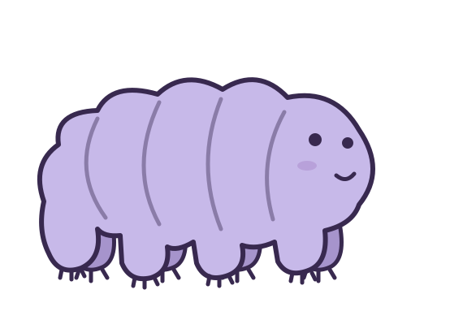

<p align="left">
  <br>
  
</p>

<p align="left">
  <a href="https://www.npmjs.com/package/tardie"></a>
  <a href="https://discord.gg/Z74jwRxz4k"></a>
</p>

> [!WARNING]
> Tardigrade is under active development. APIs may change.

# Tardigrade

Build durable actors and agents from an immutable event log, reducers, reactive views and effects. Built on [Effect](https://effect.website/).

```text
events -> reduce -> state -> views
  ^                    |
  +---- results <--- effects
```

```sh
bun add tardie
```

## Events accumulate

```ts
import { Effect, Schema } from "effect"

const Added = Schema.Struct({
  type: Schema.Literal("Added"),
  amount: Schema.Int,
})

const events: readonly (typeof Added.Type)[] = [
  { type: "Added", amount: 2 },
  { type: "Added", amount: 3 },
]
```

## Reducers build state

```ts
const reduce = (state: { count: number }, event: typeof Added.Type) => ({
  count: state.count + event.amount,
})

const current = events.reduce(reduce, { count: 0 })
// { count: 5 }
```

## Durable atoms fold the log

```ts
import { durableAtom, tree } from "tardie/core"

const counter = durableAtom({
  name: "counter",
  input: Added,
  schema: tree(Schema.Struct({ count: Schema.Int })),
  initial: { count: 0 },
  reduce: (state, event) =>
    state.set(["count"], state.read(["count"]) + event.amount),
})
```

Each edit returns an immutable version. Grove owns its representation, synchronous reads, cache and collection.

```text
                SQLite
      immutable events + Grove state
                      |
               bounded read cache
                      |
              read / select / edit
```

## Collection shapes define edits

```ts
import { appendOnly, keyValue } from "tardie/core"

const Received = Schema.Struct({
  type: Schema.Literal("Received"),
  id: Schema.String,
  text: Schema.String,
})

const State = Schema.Struct({
  document: tree(Schema.Struct({ title: Schema.String })),
  messages: appendOnly(Schema.Array(Schema.String)),
  jobs: keyValue(Schema.Struct({ status: Schema.String })),
})

const history = durableAtom({
  name: "history",
  input: Received,
  schema: State,
  initial: { document: { title: "" }, messages: [], jobs: {} },
  reduce: (state, event) => state.batch(edit => {
    edit.set(["document", "title"], event.text)
    edit.append(["messages"], [event.text])
    edit.set(["jobs", event.id], { status: "pending" })
  }),
})
```

```text
tree         -> set paths, remove fields, splice arrays
append-only  -> append entries, replace the collection
key-value    -> set or remove whole entries by key
```

## Atoms derive views

```ts
import { atom } from "tardie/core"

const count = atom(get => get(counter).read(["count"]))
const label = atom(get => `Count: ${get(count)}`)
const messages = atom(get => get(history).select(["messages"]))
```

## Effect atoms propose work

```ts
import { act, effectAtom } from "tardie/core"

const Greet = act({
  name: "greet",
  input: Schema.String,
  success: Schema.String,
  failure: Schema.String,
})
const greeting = Greet.request({ input: "Ada" })

const root = effectAtom(get => {
  const result = get(greeting.result)
  return {
    view: { count: get(count), greeting: result },
    events: {},
    acts: result.status === "pending" ? { greet: greeting } : {},
  }
})
```

Service layers execute accepted work. The runtime records results in the log; implementations must tolerate retries with the same effect reference.

```ts
const services = Greet.layer(name => Effect.succeed(`Hello, ${name}!`))
```

## Actors compose atoms

```ts
import { defineActor } from "tardie/core"

export const counterActor = defineActor("counter", Effect.succeed({
  schema: Added,
  atom: root,
}))
```

The same primitives compose an agent:

```ts
import { workspace, fetch } from "tardie/libraries"
import { agentMethods, codeMode, compact, infer, messages as trajectory } from "tardie/agent"

export const researcher = defineActor("researcher", Effect.gen(function* () {
  const system = atom("You are a careful research assistant.")
  const tools = yield* codeMode([workspace(), fetch()])
  const context = yield* compact(trajectory, {
    triggerRatio: 0.8,
    retainRatio: 0.5,
  })
  const agent = yield* infer(get => ({
    system: get(system),
    tools: get(tools),
    context: get(context),
  }))
  return { atom: agent, methods: agentMethods }
}))
```

## Hosts provide persistence

```ts
import { createActorWorker } from "tardie/platform/cloudflare"

const worker = createActorWorker({
  actor: counterActor,
  services: () => services,
})

export const ActorDO = worker.ActorObject
export const ThreadDO = worker.ThreadObject
export default worker
```

```text
Worker -> ActorDO: thread directory
             |
             +-- ThreadDO A: events + materialized state
             +-- ThreadDO B: events + materialized state
```

## Run an agent

```sh
bunx tardie init meeseeks --template quickstart
cd meeseeks
bunx wrangler dev
```

[Quickstart](docs/getting-started/quickstart.mdx) · [Cloudflare](docs/platforms/cloudflare.mdx) · [Celld](docs/platforms/celld.mdx) · [Bun](packages/examples/bun.ts) · [Agent authoring skill](skills/tardigrade/SKILL.md) · [Contributing](CONTRIBUTING.md)
