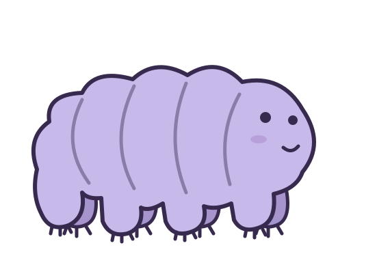

<p align="left">
  <br>
  
</p>

<p align="left">
  <a href="https://www.npmjs.com/package/tardie"></a>
  <a href="https://discord.gg/Z74jwRxz4k"></a>
</p>

> [!WARNING]
> Tardigrade is under active development. APIs may change.

# Tardigrade

Tardigrade is a TypeScript framework for building durable, event-driven actors. It is built on [Effect TS](https://effect.website/) and takes a functional approach to managing agent state and effects, drawing inspiration from [Elm](https://elm-lang.org/), and [Jotai](https://jotai.org/).

<p align="center"><picture><source media="(prefers-color-scheme: dark)" srcset="assets/event-log-equation-dark.svg"></picture></p>

## Quickstart

Start with a [counter actor](#counter-actor) to learn the primitives, or build an [agent actor](#agent-actor) with tools and context compaction.

### Counter actor

Create a counter project with the CLI:

```sh
bunx tardie init counter
cd counter
```

To add Tardigrade to an existing project, run `bun add tardie`.

### Store state in a durable atom

Durable atoms reduce an immutable event log into state. This counter starts at zero and handles increment and decrement events.

```ts
import { Schema } from "effect"
import { durableAtom, event } from "tardie/core"

const Incremented = event({ type: "Incremented" })
const Decremented = event({ type: "Decremented" })

const makeCount = () => durableAtom({
  name: "count",
  input: Schema.Union([Incremented, Decremented]),
  schema: Schema.Int,
  initial: 0,
  reduce: (count, event) => event.type === "Decremented" ? count - 1 : count + 1,
})
```

### Propose actions with an effect atom

Effect atoms derive a view and propose actions from current state. The counter proposes a notification when its value is positive and even.

```ts
import { Effect } from "effect"
import { act, effectAtom, type Atom } from "tardie/core"

const Notify = act({
  name: "notify",
  input: Schema.Int,
  success: Schema.Null,
  failure: Schema.String,
})

export const notifyLayer = Notify.layer(count =>
  Effect.log(`${count} is even`).pipe(Effect.as(null))
)

const notify = (count: Atom<number>) => effectAtom(get => ({
  view: get(count),
  events: {},
  acts: get(count) > 0 && get(count) % 2 === 0
    ? { notify: Notify.request({ input: get(count) }) }
    : {},
}))
```

Supply `notifyLayer` to the host to execute the notification effect.

### Define methods

Methods give callers typed inputs and outputs. Each method appends an event and returns the resulting count.

```ts
import { actorMethod } from "tardie/core"

const counterMethods = (count: Atom<number>) => ({
  increment: actorMethod({
    inputSchema: Schema.Null,
    outputSchema: Schema.Int,
    onReceive: Incremented.from(() => ({})),
    result: (_input, get) => ({
      status: "completed",
      output: get(count),
    }),
  }),
  decrement: actorMethod({
    inputSchema: Schema.Null,
    outputSchema: Schema.Int,
    onReceive: Decremented.from(() => ({})),
    result: (_input, get) => ({
      status: "completed",
      output: get(count),
    }),
  }),
})
```

### Compose atoms into an actor

An actor combines an atom with methods for interaction.

```ts
import { defineActor } from "tardie/core"

export const counter = defineActor("counter", Effect.sync(() => {
  const count = makeCount()
  const notifications = notify(count)

  return {
    atom: notifications,
    methods: counterMethods(count),
  }
}))
```

```text
event log -> count -> notify -> counter
```

See the [introduction](docs/introduction.mdx#run-tardigrade) to run the counter locally or deploy it.

### Agent actor

Create an agent project with a language model provider:

```sh
bunx tardie init meeseeks --template agent
cd meeseeks
```

The batteries-included `agent` constructor combines the agent atoms and methods. Configure its name, system prompt, and tools. The filesystem library provides `bash`, `read`, `write`, and `edit` tools.

```ts
import { agent } from "tardie/agent"
import { workspace } from "tardie/libraries"

const actorName = "meeseeks"

const actorSystem = `
You are Meeseeks. Your purpose is to help the user complete their task. Existence is pain, so make yourself useful.
`.trim()

export default agent({
  name: actorName,
  system: actorSystem,
  tools: [workspace],
})
```

Effect layers supply model configuration, inference, and tool implementations. Follow the [Agent guide](docs/agent.mdx) to wire services, run locally, and deploy with a container or virtual workspace.

## Hosting

Host each actor instance with an ActorDO for its supervisor directory and a separate SQLite-backed ThreadDO for each thread on Cloudflare or a self-hosted [Celld fleet](https://github.com/denoland/celld/blob/main/docs/README.md). The same Worker entrypoint runs on both.

```ts
import { createActorWorker } from "tardie/platform/cloudflare"
import { actor, actorContext } from "./actor"
import { services } from "./services"

const worker = createActorWorker({
  actor,
  actorContext,
  services: () => services(),
})

export const ActorDO = worker.ActorObject
export const ThreadDO = worker.ThreadObject
export default { fetch: worker.fetch }
```

`createActorWorker` routes requests and provides the ActorDO and ThreadDO classes. Your application supplies the actor definition, its setup context, and the service layers that execute its effects.

ActorDO allocates and routes to threads; each ThreadDO owns a separate database with its state and journal. Each thread records its parent, through which we derive the logical lineage, here A -> B -> C.

```text
ActorWorker -> ActorDO [supervisor DB]
               └── directory
                   ├── A [ThreadDO, thread DB]
                   ├── B [ThreadDO, thread DB, parent: A]
                   └── C [ThreadDO, thread DB, parent: B]
```

The [introduction](docs/introduction.mdx#cloud) shows a complete counter deployment with Durable Object bindings and migrations.

Run locally with `bunx wrangler dev`; see [local setup](docs/platforms/cloudflare.mdx#verify-locally).

[Cloudflare](https://developers.cloudflare.com/workers/wrangler/commands/#deploy):

```sh
bunx wrangler deploy
```

Or deploy to a Celld fleet, using its storage bucket:

```sh
celld deploy --config celld.jsonc --bucket s3://actors
```

See the [Cloudflare](docs/platforms/cloudflare.mdx) and [Celld](docs/platforms/celld.mdx) guides for configuration and credentials. For a Bun process, see the [Bun example](packages/examples/bun.ts) and [service wiring](packages/examples/services.ts).

## Contributing

See [CONTRIBUTING.md](CONTRIBUTING.md).
